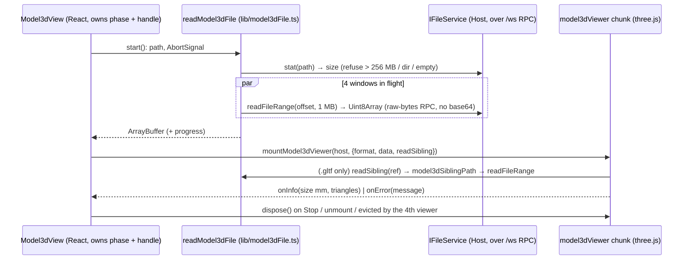

# Sando: inline 3D model viewer (spec, 2026-11-05)

Chuck (2026-11-05): "can we get 3d model viewer capabilities here in the chat / lily / Sando? so I can inspect the 3d models".
The Planner side shipped first (Project_Planner `client/src/lib/model3d*.js`). This is the Sando web workbench side, with the same
fence contract and the same readouts. Only the file transport is different.

## Product rules

- **Formats:** `.glb`, `.gltf`, `.stl`, `.3mf`, `.obj`. Draco / meshopt / KTX2-compressed glTF is refused with a message, because
  no decoder is bundled and nothing is downloaded.
- **Two entry points, one view (`components/ai-elements/model3d-view.tsx`):**
  1. **Preview pane.** Any workspace model opened as a `file` source draws in the viewer. That covers a markdown file link in a
     message (`onOpenFileLink` → `handleOpenMarkdownFileLink` → `handleOpenCodeViewer({type:"file"})`), the file tree, and the
     `zcode:workspace-path-open-request` event. It starts loading at once, because the user asked for this file.
  2. **```model3d fence** in an assistant message, once the reply has finished streaming (like ```chart):
     `{"src": "<path>", "label": "…"}`, a JSON string, or a bare path on the first line. The card shows a "View in 3D" poster and
     loads on tap. A reply full of models does not pull hundreds of MB over the socket while scrolling.
- **What a src may be:** a workspace-relative path, `./x`, an absolute path or `~/x`, resolved with `resolveMarkdownFileLink` (the
  same rules as a markdown file link, so a relative path cannot climb out of the workspace). Refused: any URL scheme (`https:`,
  `file:`, `data:`, `javascript:`), a leading `//`, any `..` segment, and any non-model extension. A refused or invalid fence shows
  the reason above the plain code block.
- **.gltf sibling files** (its `.bin`, its textures) are read only from the `.gltf`'s own folder or below it
  (`model3dSiblingPath`: no URL, no absolute path, no `..`, including `%2e%2e`). They are handed to three.js as `blob:` URLs. Every
  other URL inside a model maps to `data:,refused` (`LoadingManager.setURLModifier`), so a model can never make the browser fetch
  from anywhere. A refused buffer fails with "it needs X, which is missing or outside the model's folder". A refused texture leaves
  the shape untextured.
- **Units:** STL / 3MF / OBJ are millimetres. glTF is metres, so it is scaled ×1000. STL and 3MF are Z-up, so they are rotated to
  Y-up. Readout: `W × D × H mm` (metres from 10 m up) · triangles · file size.
- **Controls:** orbit / zoom / pan (OrbitControls), Reset (fits the bounding sphere in the narrower field of view), Wireframe,
  Light / Dark background (the default follows the page theme), Full screen (the Fullscreen API, plus a fixed overlay for iPhone; Esc
  or Close leaves it), Stop (disposes the WebGL context and returns to the poster). There is a floor grid in 10 mm cells (100 mm for
  big models).
- **Cost:** three.js and the loaders are one lazy chunk (`lib/model3dViewer.ts`, ~676 KB, ~170 KB gzip), imported only when a
  viewer starts. The viewer renders on demand (control change, resize), never in an animation loop. At most **3** live WebGL
  contexts per page: starting a 4th stops the oldest. Unmount and Stop dispose geometry, materials, textures and blob URLs, then
  force a context loss. Files over **256 MB** are refused before any read.

## Transport (state owner and event order)

The web workbench has no HTTP file route. Every file the browser sees comes over the existing RPC channel, which is the same for
desktop, web and remote workspaces. The viewer reuses `IFileService` and adds no server code.



- The service clamps one read to 1 MB. A short chunk (an older or remote service with a smaller clamp) is topped up. A stat with no
  `size` (old remote) falls back to sequential reads until an empty chunk.
- `Model3dView` is the only owner of its viewer handle. The page-level `live` list only orders eviction and holds no model state.

## Files

`packages/ui/src/lib/model3dSpec.ts` (pure: fence parser, src allowlist, sibling paths, readouts) · `lib/model3dFile.ts` (chunked
read) · `lib/model3dViewer.ts` (three.js, lazy) · `components/ai-elements/model3d-view.tsx` (`Model3dView`, `Model3dBlock`) ·
`components/ai-elements/message.tsx` (fence dispatch) · `PreviewPane.tsx` + `previewPaneContent.tsx` (pane route) ·
`styles.css` (`.sando-m3d*`) · i18n `sando.m3d.*` (en-US, zh-CN) · dependency `three@0.186.1` (MIT) + `@types/three`.

## Acceptance

- `pnpm exec tsx --test test/*.test.ts` in `packages/ui` (`test/model3d.test.ts`: extensions and units, src allowlist, fence bodies,
  sibling confinement, readouts, chunked read, short chunks, no-size fallback, size / empty / directory / abort refusals).
- Headless Chromium (SwiftShader) against a scratch build: every format draws with the right readout in the pane and in fences, the
  hostile `.gltf` files are refused without a request, Full screen opens and Esc closes it, and the page makes zero requests that are
  not loopback. Phone layout at 390 px.

## Not in scope

The Electron desktop app is not tested (the same UI package, untested there). There is no colour/material editor, no measuring
tool, no section view, and no animation playback (glTF animations stay at their bind pose). The ```model3d fence does not reach
Planner-served files from Sando (use a workspace path).
